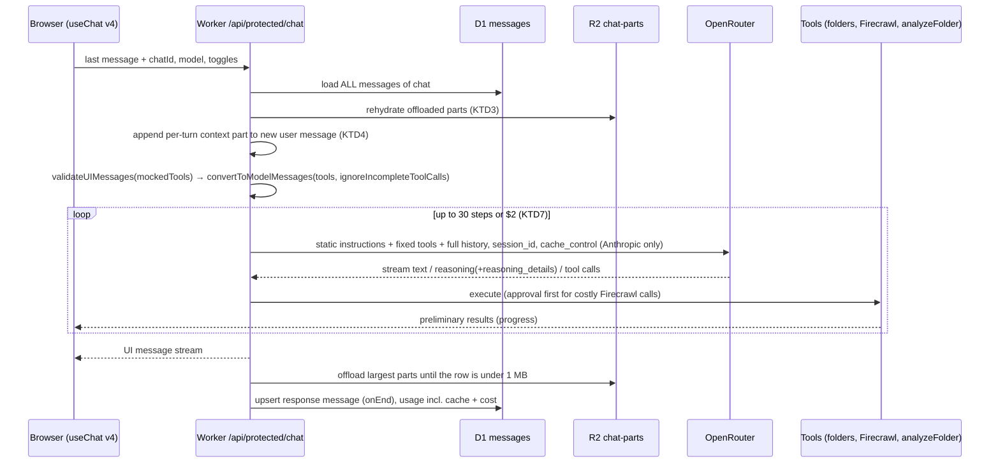

# OpenRouter-Native Chat with Full History and Research Tools - Plan

## Goal Capsule

- **Objective:** A CloudChat user asking a research question about their folders or the web gets a thorough, cited answer. Follow-up questions build on everything said and done earlier in the conversation, and a long conversation stays affordable because its history is billed as cache reads.
- **Means:** Move to AI SDK v7 with OpenRouter provider 3.1 (KTD1). Replay the entire conversation every turn in a byte-stable, cache-friendly layout (KTD2, KTD4, KTD5). Add a whole-folder analysis tool (KTD8) and Firecrawl's full v2 toolset (KTD9).
- **Authority:** Product behavior: the Requirements below win. Mechanism: KTDs win within those Requirements. A unit's Approach overrides neither.
- **Stop conditions:** Stop and ask before changing a session-settled decision (KTD2, KTD9). Also stop before trimming, summarizing or dropping any part of the conversation history, or before raising a cost cap or default beyond the values set here.
- **Execution profile:** Deep, 9 units. Each unit is a separate PR, landed in U-ID order, each deployed through CI and checked live.
- **Finishing:** `ce-work` implements and ships each PR; the owner (Gabe) confirms the live behavior.

---

## Product Contract

### Summary

Rebuild the chat turn around OpenRouter's and the AI SDK's documented conventions:
- Every turn sends the whole open conversation, including tool calls with their full results and the model's reasoning. Very large items are stored in R2 so nothing is trimmed.
- The request is laid out so OpenRouter's prompt caching hits on every follow-up.
- Answers get room to be thorough: a new system prompt, settings that match each model's capabilities, and more research steps under a per-turn cost ceiling.
- Two new research capabilities: a tool that reads every file in a folder and extracts the same fields from each, and the complete Firecrawl v2 toolset.
- Long runs show live progress, and each reply shows its token, cache and cost figures.

### Problem Frame

Answers are short and shallow, and the model forgets its own earlier work. Concretely:
- The system prompt opens with "Give concise and helpful responses."
- Only the last 12 messages are reloaded each turn (`packages/api-routes/src/lib/chat/chat-request.ts`).
- Tool results are wiped before saving (`packages/api-routes/src/lib/chat/omit-document-text.ts`).
- History is converted with a bare `convertToModelMessages` call.
- The loop stops at 6 steps, and no verbosity or output budget is sent.
- Firecrawl is used for a single endpoint, and web search goes through OpenRouter's deprecated `web` plugin.
- The OpenRouter provider in use (2.10.0) is the last v6 line. Current OpenRouter support (3.1.0) requires AI SDK v7.
- The request prefix changes every turn: the system prompt carries the time to the minute, and the tool list varies with toggles. Prompt caching therefore can't help even when history is sent.

### Key Decisions

- **The entire open conversation is replayed every turn, with nothing trimmed, pruned or summarized.** (session-settled: user-directed — chosen over a 12-message window and over dropping raw tool text from older turns: the model must keep its previous actions in context, laid out to OpenRouter's caching conventions.) Governs R1, R2, R3.
- **Firecrawl's full toolset is the web layer.** (session-settled: user-directed — chosen over OpenRouter's web search server tool and plugin as the main web layer: the owner wants every Firecrawl capability available to the model.) Governs R9, R10, R11.
- **All five improvement areas ship as one package.** (session-settled: user-approved — chosen over the quick settings pass alone: depth settings, folder analysis, full history, web tooling and progress were approved together.) Governs R4–R14.

### Requirements

**Conversation history**
- R1. Every turn sends the model the entire open conversation: every message, every tool call with its complete result, reasoning with its provider metadata, and attachment content exactly as first sent.
- R2. Nothing in the history is trimmed or summarized. If a conversation exceeds the selected model's context window, the user sees a clear message naming the limit and suggesting a larger-context model. That includes overflow partway through a turn, where the steps completed before the error are still saved.
- R3. A replayed turn is byte-identical to how it was first sent, so the cached prefix stays valid.

**Answer depth**
- R4. Answers are thorough by default, with length matched to the question; research questions get structured, cited answers.
- R5. Each request uses the strongest output settings the selected model supports: verbosity and output budget always, reasoning effort set to high when the user turns reasoning on. A setting the model doesn't support is never sent.
- R6. A turn can research for up to 30 steps and stops early once its cost reaches the per-turn ceiling.

**Folder research**
- R7. The model can analyze every file in the chat's folders (up to 100 files per run) by extracting the same requested fields from each file, and gets back one table it can count and quote from.
- R8. The model the user picked writes the final answer. Per-file reading uses a cheap model.

**Web**
- R9. Every current Firecrawl v2 capability is available as a tool: scrape (all formats and actions), search (including research, government and developer indexes), map, crawl, batch scrape, agent, interact, parse, monitors and credit usage.
- R10. Actions that can spend many credits (crawl, batch scrape, agent, interact) ask the user for approval first and run under hard caps.
- R11. The web search toggle enables the Firecrawl tools. OpenRouter's deprecated `web` plugin is no longer used.

**OpenRouter integration**
- R12. Chat runs on the current OpenRouter provider. It uses sticky routing per conversation and each provider family's documented caching convention.
- R13. Each reply records input, output, cache-read, cache-write and reasoning tokens plus cost, and the chat shows them.

**Progress**
- R14. Long-running tools (folder analysis, crawls, agent jobs) show live progress in the chat.

### Success Criteria

- The Maya question ("most frequent success indicator across the Building Now Podcast transcripts") gets an answer that covers all 26 transcripts, with counts and verbatim quotes. A follow-up question answers from that work without re-running the tools unless asked.
- From the second turn of a conversation, the reply's usage shows cache-read tokens above zero on cache-capable models (Anthropic, OpenAI, Gemini, DeepSeek).
- No saved message exceeds D1's 2 MB row limit, regardless of how much a turn read.

### Scope Boundaries

- No history trimming, compaction, summarization or `middle-out` compression in any form (Key Decisions).
- No OpenRouter Agent SDK (`@openrouter/agent`) and no Firecrawl MCP or `firecrawl-aisdk` (KTD10, KTD9).
- The Claude Code token integration belongs to another agent and is untouched.
- Considered and not built: a per-user Firecrawl credit budget. The approval gate and per-call caps (R10) catch spend at the moment it happens. Revisit if credit usage shows abuse.
- Considered and not built: model fallbacks (`models: []`). These are reliability, not depth. Revisit after uptime problems.

#### Deferred to Follow-Up Work

- OpenRouter server tools other than web search (`openrouter:web_fetch`, `datetime`, `subagent`, `advisor`, `fusion`). Provider 3.1 has no helpers for them, and it sends web search parameters at the wrong level. Add them when the provider supports them.
- Composio activation still waits on a dedicated project key (unchanged).

---

## Planning Contract

### Key Technical Decisions

- KTD1. **Upgrade `ai` to 7.x, `@ai-sdk/react` to 4.x and `@openrouter/ai-sdk-provider` to 3.1 together, and drop `workers-ai-provider`.** Provider 3.x peers on `ai ^7`, and 2.10 is the final v6-era line. Neither package has static Node imports, so the Worker bundle and `nodejs_compat` are fine (to be confirmed in U1). `workers-ai-provider` only backs an unused `NEXT_PUBLIC_LLM_MODELS` mode; `env.AI` calls for `toMarkdown` and AI Search don't use it. Apply the codemod (`npx @ai-sdk/codemod v7`), then the renames listed in U1.
- KTD2. **Full history per R1 and R2.** Concretely:
  - Load every message of the chat.
  - Remove `omitDocumentText`.
  - Stream with `toUIMessageStream({ stream, originalMessages, generateMessageId, onEnd })` and save from `onEnd`, upserting on continuation.
  - Convert with `convertToModelMessages(messages, { tools, ignoreIncompleteToolCalls: true })`.

  (session-settled: user-directed — chosen over a 12-message window and dropping older tool text: the model must keep its previous actions in context.)
- KTD3. **Offload large parts to R2 by reference and rehydrate them byte-for-byte before conversion.** D1 limits the whole row to 2 MB, and every part of a message shares one `parts` column, so the budget is per message.
  - If a message's serialized parts exceed 1 MB, offload parts largest-first (any part over 16 KB is eligible) until the row is under 1 MB.
  - Offloaded parts are tool outputs, attachment text or file data, written to `chat-parts/<chatId>/<messageId>/<partIndex>`. The saved part carries a reference marker.
  - Loading restores the exact original value, so R1 and R3 hold.
  - Both thresholds are constants.
- KTD4. **Cache-stable layout.**
  - System prompt: `instructions` carries only static text.
  - Server-added content is saved on the new user message as data parts. That covers the per-turn context (date and time, location, project block, selected saved prompts) as `data-turnContext`, and attachment and document text as `data-attachmentText`.
    - `convertToModelMessages`' `convertDataPart` turns them into model text deterministically, so earlier turns replay unchanged.
    - The user's bubble ignores data parts, so it shows only what the user typed.
    - The server drops these data parts from client-sent messages (retry, edit) before adding them again, so a message never carries two copies.
  - Tools: the tool set is fixed and identically ordered on every turn, using v7 `toolOrder` or a sorted registration.
  - Gating: tools that need a folder or the web toggle are always registered and explain at call time when their precondition is off. Changing the tool list would invalidate Anthropic's whole cache.
- KTD5. **Per-provider caching.**
  - Send `session_id = chatId` through `providerOptions.openrouter` for sticky routing.
  - Keep top-level `cache_control` (automatic breakpoint) for Anthropic models only, with `ttl: "1h"` so follow-ups after a break still hit the cache (writes cost 2× instead of 1.25×). Detect Anthropic models by family, including `~anthropic/` aliases.
  - Send no `cache_control` to OpenAI, Gemini, DeepSeek or Grok, which cache automatically. On Gemini, `cache_control` turns on paid explicit caching.
  - Remove `extraBody.transforms: ["middle-out"]`, which drops messages (contradicts R2).
- KTD6. **Capability-gated output settings from the OpenRouter catalog's `supported_parameters`.**
  - `verbosity: "high"` when the model supports `verbosity`.
  - `reasoning: { effort: "high" }` when the user toggles reasoning and the model supports `reasoning`.
  - `maxOutputTokens` large enough that reasoning can't consume the whole budget, capped at the model's maximum. Sent only when the model supports `max_tokens`.
  - `provider.require_parameters: true`. This is safe because only supported parameters are sent, and the menu lists only models that support both `tools` and `tool_choice` (the AI SDK sends `tool_choice` whenever tools are present).
  - The catalog fetch (`packages/api-routes/src/providers/openrouter-catalog.ts`) already receives `supported_parameters` and the maximum completion tokens. Its output gains both fields.
- KTD7. **Loop limits.** `stopWhen: [isStepCount(30), costCeiling]`. This is the AI SDK counterpart of OpenRouter Agent SDK's `maxCost`.
  - **Turn cost** is a per-turn counter owned by the chat handler. It sums each step's `providerMetadata.openrouter.usage.cost` plus the cost of model calls made inside tools (analyzeFolder's extractions). The same counter feeds the reply's cost figure (R13).
  - **Cost ceiling:** `costCeiling` stops at $2.00 of turn cost (Assumptions).
  - **Final answer:** stop conditions are only checked after a step, so a limit can trip right after a tool call and leave no answer. To prevent that, a `prepareStep` sets `toolChoice: "none"` when the next step is step 30 or turn cost reaches 85% of the ceiling. The model then writes its answer from what it has gathered and says what it didn't cover. The tools stay registered, so the cached tool list is unchanged.
- KTD8. **`analyzeFolder` tool.**
  - Read each in-scope file with the existing `readFile` lookup.
  - Extract the requested fields per file with `generateText` plus `Output.object`, on `openai/gpt-6-luna` with the `response-healing` plugin (non-streaming).
  - Run 8 files at a time, up to 100 files.
  - Stream progress as preliminary tool results (an async-generator `execute`).
  - Add each extraction call's cost to the turn cost counter (KTD7).
  - Return one row per file, with errors per row.
- KTD9. **Firecrawl through our own typed v2 client.** Extend `packages/api-routes/src/lib/firecrawl.ts` and add one tool per capability family.
  - Approval: `needsApproval` on crawl, batch scrape, agent and interact.
  - Caps: crawl `limit` 100, batch 100 URLs, agent `maxCredits` 500.
  - State: interact session ids travel in tool outputs and inputs, never in module state.
  - Output size: every tool caps what it returns to the model, following `fetchWebContent`'s 60,000-character pattern, because results stay in the history forever (R2).
    - Scrape returns at most 60,000 characters per page.
    - Crawl, batch and agent status return the page list with titles, URLs and a short excerpt per page, at most 100,000 characters in total.
    - The model reads full pages one at a time with the scrape tool.
  - Deprecated `extract` is skipped.
  - Size: `firecrawl-aisdk` would add about 380 KB, a second zod and module-global sessions shared across users. The hosted MCP would add about 27k schema tokens per step and extra round trips.

  (session-settled: user-directed — chosen over OpenRouter web search as the main web layer: the owner wants all Firecrawl capabilities.)
- KTD10. **Adopt `@openrouter/sdk` standalone functions for the model catalog. Skip `@openrouter/agent`.** The client SDK gives a typed catalog with endpoint parameters in about 34 KB using standalone functions. The Agent SDK is beta, bundles a second client SDK and emits Responses items that `useChat` can't consume, and the AI SDK already runs the loop.
- KTD11. **`mockedTools` keeps a schema for every tool ever saved.** That includes retired ones such as `extractFromWeb`. In v7, `validateUIMessages` turns unknown saved tools into dynamic parts and `convertToModelMessages` replaces their output with "Tool output omitted", which would break R1.

### High-Level Technical Design

One chat turn after this plan:

Request layout, which is the order that caching depends on:

| Position | Content | Changes between turns? |
|---|---|---|
| 1 | Tools, in a fixed order | Never |
| 2 | `instructions`: static system prompt | Never |
| 3 | Earlier messages, replayed exactly as saved | Never (append-only) |
| 4 | New user message: text, attachments, per-turn context part | New each turn |

### Assumptions

- The per-turn cost ceiling is $2.00 and the step limit 30 (KTD7). Both are constants, easy to change.
- The per-message row budget is 1 MB and parts over 16 KB are eligible for offload (KTD3).
- Cheap extraction model is `openai/gpt-6-luna` ($0.10/$0.50 per M). The Firecrawl caps are those in KTD9.
- For the `maxOutputTokens` default, aim around 32K tokens, capped by the model.
- Anthropic cache entries live 1 hour (KTD5). OpenAI, Gemini, DeepSeek and Grok caching is automatic and short-lived, so a follow-up after a long break on those models is billed at full input price.

### Sequencing

U1 is the foundation. U2 must land before U3, because without offloading, full history can exceed D1's row limit. U4 depends on U3, since the layout only pays off with full history.
- U5 depends on U1.
- U6 and U7 depend on U1 and U4.
- U8 depends on U5, U6 and U7.
- U9 depends on U5.

---

## Implementation Units

### U1. Upgrade to AI SDK v7 and OpenRouter provider 3.1

- **Goal:** Run every AI surface on `ai` 7, `@ai-sdk/react` 4 and `@openrouter/ai-sdk-provider` 3.1 with no behavior change.
- **Requirements:** R12.
- **Dependencies:** none.
- **Files:**
  - `packages/api-routes/package.json`, `apps/api/package.json`, `apps/web/package.json`, `pnpm-lock.yaml`
  - `packages/api-routes/src/lib/chat/chat-handler.ts`, `standard-chat-handler.ts`
  - `packages/api-routes/src/providers/providers.ts`, `generate-title.ts`
  - `packages/api-routes/src/routes/protected/search/route.ts`, `completion/route.ts`
  - `packages/api-routes/src/lib/tools/extract-from-web.ts`, `generate-file.ts`
  - Artifact servers: `text-server.ts`, `code-server.ts`
  - `packages/api-routes/src/schemas/metadata-schema.ts`
  - `apps/web/components/custom/chat.tsx`, `agent-message.tsx`
  - Test: `apps/api/test/history-conversion.test.ts`
- **Approach:**
  1. Bump the three packages together and remove `workers-ai-provider` and its `providers.ts` branch (KTD1).
  2. Run the v7 codemod.
  3. Apply the v7 renames: `system`→`instructions`, `stepCountIs`→`isStepCount`, `onFinish`→`onEnd`, `fullStream`→`stream`, `experimental_throttle`→`throttle`.
  4. Switch to `toUIMessageStream({ stream: result.stream, … })`.
  5. Usage metadata moves to `inputTokenDetails.cacheReadTokens` / `cacheWriteTokens` and `outputTokenDetails.reasoningTokens`.
  6. Add a `reasoning-file` case to the message part switch.
  7. Keep `mockedTools` complete (KTD11).
- **Patterns to follow:** existing `apps/api/test/*.test.ts` vitest files that import built `@workspace/api-routes` modules.
- **Test scenarios:**
  - A saved assistant message with a reasoning part carrying `providerMetadata.openrouter.reasoning_details` converts to a model message whose reasoning keeps those details in `providerOptions`.
  - A saved `tool-extractFromWeb` part from an old chat validates and converts with its output intact.
  - The existing build-metadata-filter and document-search tests still pass.
- **Verification:**
  - Typecheck passes in api-routes, apps/api and apps/web.
  - The Worker bundle builds and its gzip size is reported in the PR.
  - A chat with tool use and reasoning works on a staging Worker, then in production.

### U2. Offload large message parts to R2

- **Goal:** Save any message, however large its tool outputs or attachments, without hitting D1's 2 MB row limit, and load it back unchanged.
- **Requirements:** R1, R3.
- **Dependencies:** U1.
- **Files:**
  - New `packages/api-routes/src/lib/chat/part-storage.ts`
  - `packages/api-routes/src/lib/queries/messages.ts`
  - `packages/api-routes/src/lib/chat/chat-handler.ts`
  - Test: `apps/api/test/part-storage.test.ts`
- **Approach:**
  1. Before saving, while the message is over its budget (KTD3), replace its largest eligible part with a reference marker and write the original JSON to R2 under the chat's prefix.
  2. When loading a chat, resolve the markers in parallel.
  3. Deleting a chat also deletes its `chat-parts/<chatId>/` prefix.
- **Test scenarios:**
  - A tool output of 3 MB is saved as a reference. The D1 row stays under 2 MB, and loading returns a value deep-equal to the original.
  - A message with thirty readFile outputs of 150 KB each (none large on its own) saves with its D1 row under 1 MB and loads back deep-equal.
  - A 10 KB part in a small message stays inline, with no R2 write.
  - A message with two large parts writes two objects and restores both in order.
  - A missing R2 object loads as a visible placeholder part, logs an error and doesn't fail the whole chat load.
  - Deleting a chat removes its offloaded objects.
- **Verification:**
  - Tests pass.
  - In production, a turn that reads several whole transcripts saves without error and its D1 row stays small.

### U3. Replay the entire conversation every turn

- **Goal:** The model receives the complete open conversation on every turn (KTD2).
- **Requirements:** R1, R2.
- **Dependencies:** U2.
- **Files:**
  - `packages/api-routes/src/lib/chat/chat-request.ts`, `chat-handler.ts`, `standard-chat-handler.ts`
  - Remove `packages/api-routes/src/lib/chat/omit-document-text.ts` and its test from `apps/api/test/document-search.test.ts`
  - Test: `apps/api/test/full-history.test.ts`
- **Approach:**
  1. Drop the 12-message cap and load the whole chat (rehydrated, U2).
  2. Remove `extraBody.transforms: ["middle-out"]` (KTD5) in this same unit. Otherwise OpenRouter silently compresses oversized prompts while full history is live, and the R2 message can never fire.
  3. Save the user message after attachments and document context are added (as data parts, KTD4), so it replays as sent.
  4. Saved file parts are trusted on reload. The no-file-parts rule stays for client-sent messages only.
  5. Stream with `originalMessages` and save in `onEnd`, upserting on continuation.
  6. **Continuations.** A tool-approval response arrives as an assistant message whose id matches the last stored message.
     - Replace the stored copy instead of appending it.
     - Copy only the approval responses from the client onto the stored parts.
     - Skip the per-turn context part and the user-message save.
  7. Convert with `tools`, `ignoreIncompleteToolCalls` and `convertDataPart`.
  8. Map OpenRouter's context-length error to the R2 message in `handleError`. A mid-turn overflow still saves the steps completed so far.
- **Test scenarios:**
  - A 40-message chat sends all 40 messages to the model in order.
  - The previous turn's `readFile` output reaches the model in full on the next turn.
  - An attachment's extracted text, added in turn 1, is present in turn 3's model input.
  - An aborted turn's tool call in `input-available` state is skipped and doesn't throw.
  - An OpenRouter context-length error produces the user-facing message naming the limit and suggesting a larger-context model.
  - A context-length error at step 4 of a turn saves steps 1–3 and shows the R2 message.
  - No request carries `transforms`.
  - An approval continuation sends the assistant message to the model once, with the stored tool outputs, and doesn't add a second context part.
- **Verification:**
  - Tests pass.
  - In the live Maya chat, a follow-up answers from the previous turn's transcripts without re-reading them.

### U4. Cache-stable request layout and per-provider caching

- **Goal:** Follow-up turns hit OpenRouter's prompt cache (KTD4, KTD5).
- **Requirements:** R3, R12.
- **Dependencies:** U3.
- **Files:**
  - `packages/api-routes/src/lib/chat/chat-handler.ts`, `standard-chat-handler.ts`, `project-context.ts`
  - `packages/api-routes/src/providers/providers.ts`, `prompts.ts`
  - Context-dependent tools: `extract-from-documents.ts`, `read-file.ts`, the web toggle path
  - `apps/web/components/custom/user-message.tsx` (render text parts only)
  - Test: `apps/api/test/request-layout.test.ts`
- **Approach:**
  1. Split `buildSystemPrompt` into static instructions and a per-turn `data-turnContext` part (KTD4), then append that part to the new user message before it's saved.
  2. Register the full tool set on every turn in a fixed order. Tools whose precondition is off return a short explanation.
  3. Set `session_id`, and apply Anthropic-only top-level `cache_control` with family detection.
- **Test scenarios:**
  - Two consecutive turns, built at different times with different folder selections, produce identical `instructions`.
  - Both turns produce the same tool names in the same order.
  - The new user message carries a context data part with the date, time and project block, and that part is saved.
  - A retried or edited message carries exactly one context part after the server processes it.
  - `extractFromDocuments` called with no folder selected returns an explanation instead of searching.
  - Settings for `anthropic/claude-sonnet-5.5` and `~anthropic/claude-sonnet-latest` include top-level `cache_control`; `openai/gpt-6-luna` and `google/gemini-4-argon` don't.
  - Every request carries `session_id` equal to the chat id.
- **Verification:**
  - Tests pass.
  - In production, the second turn of a chat on Sonnet 5.5 and on GPT-6 Luna reports cache-read tokens above zero.

### U5. Answer depth: prompt, capability-gated settings, loop limits

- **Goal:** Thorough answers within a bounded cost (KTD6, KTD7).
- **Requirements:** R4, R5, R6.
- **Dependencies:** U1.
- **Files:**
  - `packages/api-routes/src/providers/prompts.ts`, `providers.ts`, `openrouter-catalog.ts`
  - `packages/api-routes/src/lib/chat/standard-chat-handler.ts`
  - New `packages/api-routes/src/lib/chat/stop-conditions.ts`
  - Test: `apps/api/test/model-settings.test.ts`
- **Approach:**
  1. Rewrite the static system prompt:
     - Remove "concise".
     - Ask for thoroughness matched to the question.
     - Ask the model to research until claims are backed and to quote sources.
     - Ask for headings and tables for research answers.
     - Ask it to say what it didn't cover.
  2. Extend the catalog output with `supported_parameters` and the maximum completion tokens. Require `tool_choice` as well as `tools` in its filter. Then build model settings from it (KTD6).
  3. Add the turn cost counter, the cost-ceiling stop condition and the final-answer `prepareStep` (KTD7).
- **Test scenarios:**
  - A model that doesn't list `max_tokens` gets no output budget. A model that lists `tools` but not `tool_choice` is left out of the menu.
  - A turn whose cost crosses 85% of the ceiling after a tool-call step still ends with a final text answer.
  - A model whose parameters include `verbosity` and `reasoning` gets `verbosity: "high"`, plus `effort: "high"` when reasoning is toggled.
  - A model without `verbosity` never receives it.
  - Every request has `require_parameters: true` and an output budget no larger than the model's maximum.
  - The cost ceiling stops the loop after the step whose cumulative cost crosses $2.00.
  - The loop continues while the cost is below $2.00 and steps are below 30.
- **Verification:**
  - Tests pass.
  - The Maya question produces a multi-section answer with citations in production.

### U6. Firecrawl v2 client and full toolset

- **Goal:** The model can use every Firecrawl v2 capability, with approval and caps on costly actions (KTD9).
- **Requirements:** R9, R10, R11.
- **Dependencies:** U1. U4 for registering the tools in the fixed set.
- **Files:**
  - `packages/api-routes/src/lib/firecrawl.ts`
  - New `packages/api-routes/src/lib/tools/firecrawl-tools.ts`
  - `packages/api-routes/src/lib/tools/index.ts`, `standard-chat-handler.ts`, `packages/api-routes/src/types/custom-ui-tools.ts`
  - `apps/web/components/tools/` (new cards, approval prompt), `apps/web/components/custom/agent-message.tsx`
  - Test: `apps/api/test/firecrawl-tools.test.ts`
- **Approach:**
  1. Write a typed client per v2 endpoint family: scrape, search with its indexes, map, crawl, batch, agent, interact, parse, monitor and team credit usage.
  2. Add tools on top of the client. Async jobs get a start tool plus a status tool.
  3. Approval uses AI SDK `needsApproval` with the v4 `addToolApprovalResponse` UI.
  4. The web toggle gates these tools at call time (KTD4).
  5. `extractFromWeb` is retired from registration but kept in `mockedTools`.
  6. The existing `fetchWebContent`, `saveToFolder` and YouTube import keep their current behavior on the shared client.
- **Test scenarios (with a mocked fetch):**
  - `firecrawlSearch` with `sources: research` calls `/v2/search/research/papers` with the API key and returns titles, URLs and content.
  - `firecrawlCrawl` with `limit: 500` is sent with `limit: 100`, and the tool is marked as needing approval.
  - `firecrawlAgent` caps `maxCredits` at 500.
  - `firecrawlInteract` returns a session id; a follow-up call with that id executes in the same session, and stop deletes it.
  - A 402 response (out of credits) returns a readable error to the model instead of throwing.
  - A 100-page crawl status result stays under 100,000 characters, and a scrape of a very long page returns at most 60,000.
  - With the web toggle off, any Firecrawl search tool returns the "web search is off" explanation.
- **Verification:**
  - Tests pass.
  - In production, a crawl request shows an approval card. After approval, the crawl runs and its status is reported.

### U7. analyzeFolder tool

- **Goal:** The model can extract the same fields from every file in the chat's folders and get one table back (KTD8).
- **Requirements:** R7, R8.
- **Dependencies:** U1. U4 for fixed registration.
- **Files:**
  - New `packages/api-routes/src/lib/tools/analyze-folder.ts`
  - `packages/api-routes/src/lib/tools/read-file.ts` (share the lookup)
  - `packages/api-routes/src/lib/tools/index.ts`, `standard-chat-handler.ts`, `packages/api-routes/src/types/custom-ui-tools.ts`
  - Test: `apps/api/test/analyze-folder.test.ts`
- **Approach:**
  1. Input: the fields to extract (name plus description) and optional file names.
  2. Scope: the same files and folders `readFile` may read.
  3. Run per-file structured extraction 8 at a time, yielding progress after each file.
  4. The final output lists rows per file plus any skipped files, and notes the cap when more than 100 files exist.
  5. Prompt guidance tells the model to use it for cross-document questions.
- **Test scenarios (with a stubbed model and R2):**
  - Three files produce three rows with the requested fields filled in.
  - One file failing extraction yields an error row for that file, and the other rows succeed.
  - A folder with 130 files analyzes 100 and reports that 30 were skipped.
  - Progress is yielded once per completed file.
  - A file outside the chat's folders is rejected.
  - The stubbed extraction calls' cost shows up in the turn cost total.
- **Verification:**
  - Tests pass.
  - The live Maya question reports results for all 26 transcripts with counts.

### U8. Live progress and usage display

- **Goal:** Users see long runs progressing, and each reply's tokens, cache and cost.
- **Requirements:** R13, R14.
- **Dependencies:** U5, U6, U7.
- **Files:**
  - `apps/web/components/tools/` (analyze-folder card, Firecrawl job cards)
  - `apps/web/components/custom/agent-message.tsx`
  - `packages/api-routes/src/schemas/metadata-schema.ts`, `standard-chat-handler.ts` (cost into message metadata)
  - Test: `apps/web` unit test for the usage formatter, colocated with the existing web test setup (or `apps/api/test/usage-metadata.test.ts` if web has no runner)
- **Approach:**
  1. Render preliminary tool results as progress ("Reading 7 of 26").
  2. Firecrawl job cards show status and pages processed.
  3. Message metadata gains cache-read, cache-write and reasoning tokens plus the turn cost (KTD7, so tool-internal model calls are included). The message footer shows them.
- **Test scenarios:**
  - Usage with 120,000 input tokens of which 100,000 were cache reads, and cost 0.0421, formats as cache-read share and cost.
  - Metadata built from a two-step turn sums both steps' costs.
- **Verification:**
  - In production, an analyzeFolder run visibly counts up, and the reply footer shows cache and cost figures.

### U9. Model catalog through @openrouter/sdk

- **Goal:** The model menu and capability gating use OpenRouter's typed client SDK (KTD10).
- **Requirements:** R5, R12.
- **Dependencies:** U5.
- **Files:**
  - `packages/api-routes/src/providers/openrouter-catalog.ts`, `packages/api-routes/package.json`
  - Test: `apps/api/test/openrouter-catalog.test.ts`
- **Approach:**
  1. Replace the hand-rolled catalog fetch with the SDK's standalone models function.
  2. Keep U5's filter and output shape unchanged.
- **Test scenarios:**
  - A stubbed catalog response maps to the same menu entries as today.
  - Models without `tools` support are excluded.
  - Each entry exposes `supported_parameters` and the maximum output.
- **Verification:**
  - Tests pass.
  - The model menu in production lists the same models as before.
  - The bundle grows by no more than about 40 KB gzip.

---

## Verification Contract

| Gate | Command / check | Applies to |
|---|---|---|
| Package build | `pnpm --filter @workspace/api-routes build` | All units |
| Typecheck | `npx tsc --noEmit -p apps/api` and `-p apps/web` | All units |
| Unit tests | `pnpm --filter api test` (vitest in `apps/api/test/`) | All units |
| Bundle size | Worker gzip size from the CI deploy log; report the delta in each PR | U1, U6, U9 |
| Staging smoke | Throwaway staging Worker (local `wrangler dev` hangs in this sandbox) | U1, U3 |
| Live check | Deploy via CI on merge; run the scenario named in the unit's Verification | All units |

## Definition of Done

- Every unit's tests pass and its live check was observed in production.
- No code path trims, prunes, summarizes or compresses conversation history (`middle-out` removed, 12-message cap removed, `omitDocumentText` removed).
- The second turn of a conversation shows cache-read tokens above zero on a cache-capable model.
- Old chats (saved before the upgrade, including retired tool parts) still open and continue without errors.
- Abandoned experimental code from attempts that didn't pan out is removed from each PR.

---

## Risks & Dependencies

| Risk | Mitigation |
|---|---|
| v7 behavior changes break saved chats (unknown tools become dynamic with omitted output) | KTD11 keeps `mockedTools` complete; U1's test covers an old `extractFromWeb` part |
| Full history makes long chats expensive | Prompt caching (U4) makes repeated history cache reads (0.1× on Anthropic, 0.25–0.5× on OpenAI); per-turn cost ceiling (KTD7) |
| A conversation outgrows the model's context window | R2 surfaces it clearly; nothing is trimmed (Key Decisions) |
| Worker memory with very large histories | Typical chats stay well under the 128 MB isolate limit. U2 keeps D1 rows small. Large rehydrated parts are held only for the request |
| Firecrawl credit spend | Approval and caps on costly actions (KTD9) |
| `require_parameters: true` blocks routing if catalog parameters are stale | Settings come from the live catalog. If a request still fails with a routing error, the error is logged and shown, never silently retried without the parameters |

## Sources

- OpenRouter prompt caching: https://openrouter.ai/docs/guides/best-practices/prompt-caching
- OpenRouter with the Vercel AI SDK: https://openrouter.ai/docs/guides/community/vercel-ai-sdk
- OpenRouter Agent SDK: https://openrouter.ai/docs/agent-sdk/overview
- OpenRouter TypeScript SDK: https://openrouter.ai/docs/client-sdks/typescript/overview
- OpenRouter server tools: https://openrouter.ai/docs/guides/features/server-tools
- AI SDK v7 migration guide: https://ai-sdk.dev/docs/migration-guides/migration-guide-7-0
- AI SDK chat persistence: https://ai-sdk.dev/docs/ai-sdk-ui/chatbot-message-persistence
- `@openrouter/ai-sdk-provider` README: https://github.com/OpenRouterTeam/ai-sdk-provider
- Firecrawl v2 API: https://docs.firecrawl.dev/api-reference/v2-openapi.json
- Firecrawl billing: https://docs.firecrawl.dev/billing
- Current wiring: `packages/api-routes/src/lib/chat/chat-request.ts` (12-message cap), `omit-document-text.ts`, `standard-chat-handler.ts` (`stepCountIs(6)`), `providers/providers.ts` (`middle-out`, `web` plugin), `providers/prompts.ts` ("Give concise…")
